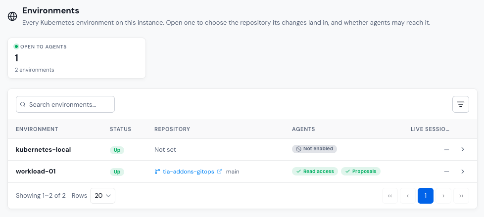
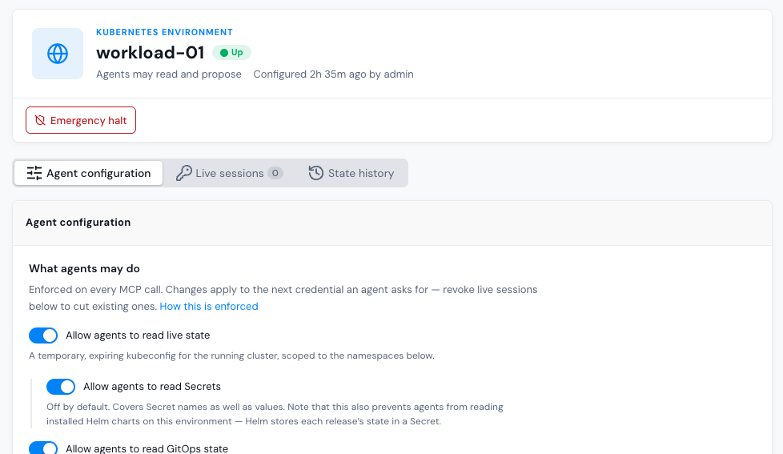

# Environments

**Environments** lists every Kubernetes environment on the Portainer instance and is where administrators decide what agents may do in each one. It's under **Administration** and only administrators can see it. Non-admin users can ask their agent which environments they can reach. The agent sees exactly what they see in Portainer.


Every environment is **closed to agents** until an administrator opens it. Each setting is enforced on the server on every MCP call, not just hidden in the interface.


<figure><figcaption></figcaption></figure>

## The environment list

The list shows each environment's **Status** (Up or Down), the **Repository** and branch it deploys from, what **Agents** may do there (**Read access**, **GitOps reads**, **Proposals**, or **Not enabled**), and how many **Live sessions** are held against it. Use the search box, the filter menu, or the summary cards at the top to narrow the list.


The list counts an environment as open to agents when it allows live reads, GitOps reads, or proposals. An environment that only allows GitOps reads is shown as **GitOps reads** and counts as open.


Click an environment to open it. Its page has three tabs: **Agent configuration**, **Live sessions**, and **State history**. The **Emergency halt** button is in the page header.

<figure><figcaption></figcaption></figure>

## Agent configuration

Every switch is off by default. Change the settings you need, then click **Save configuration**.

#### What agents may do

| Setting                                         | Overview                                                                                                                                                                                                                                                                                                          |
| ----------------------------------------------- | ----------------------------------------------------------------------------------------------------------------------------------------------------------------------------------------------------------------------------------------------------------------------------------------------------------------- |
| Allow agents to read live state                 | Agents can request a temporary, expiring, read-only kubeconfig for the running cluster, scoped to the namespaces below.                                                                                                                                                                                           |
| Allow agents to read Secrets                    | Shown when live reads are on. Covers Secret names as well as values. This also affects Helm: without it, agents can't read installed Helm releases, because Helm stores each release's state in a Secret. See [Secrets](environments.md#secrets) below.                                                           |
| Allow agents to read GitOps state               | Agents can clone the manifests in the repository below: what is supposed to be running, as opposed to what is. This is enough on its own for a review or a drift check. Turning it off also turns off proposals and revokes every Git clone credential held against the environment.                              |
| Allow agents to propose changes to GitOps state | Agents can open change requests against the repository below, and against the repositories behind what's already deployed here. Nothing reaches the cluster until a person approves it. Needs GitOps reads, because an agent can't edit what it can't read.                                                                                                                           |
| Allow cluster-scoped objects                    | Shown when proposals are on. ClusterRoles and their bindings, CRDs, admission webhooks, StorageClasses, and similar objects live in no namespace, so the namespace list can't bound them. When off, a proposal containing one is refused. When on, it's allowed and flagged in the change request for the reviewer. |


With **Allow cluster-scoped objects** on, an approved ClusterRoleBinding or webhook applies to the whole cluster, whatever namespaces agents are limited to. Prefer a Role and RoleBinding where you can.


#### Which repository

Shown when GitOps reads are on. This is the Git repository that describes the environment. Agents read it to see what should be running, and propose into it when proposals are on.

| Field      | Overview                                                                                                                                                                                                                                   |
| ---------- | ------------------------------------------------------------------------------------------------------------------------------------------------------------------------------------------------------------------------------------------ |
| Repository | Optional. One of the GitOps sources configured in Portainer, as a home for new manifests and adoptions. Choose **None — agents use the stacks and reconcilers they find** to let agents work only in the repositories behind what's already deployed here. If no sources are listed, add one in Portainer first. |
| Branch     | The branch to read and propose against. Leave empty to use the repository's default branch.                                                                                                                                                |
| Directory  | The only part of the repository agents can see, for example `clusters/prod`. Their clone is rooted here, and files outside it can't be read or changed. New manifests are written here too. Leave empty to give them the whole repository. |

| Setting | Overview |
| ------- | -------- |
| Agents may propose into the repositories Argo CD and Flux deploy from | Off by default. Lets agents clone and propose into what an in-cluster Argo CD Application or Flux Kustomization or HelmRelease deploys, using its owner's own Git credential. Approving merges; Argo CD or Flux applies it. Turning off GitOps reads turns this off too. |

The repository can be on any [supported Git host](../connect-to-github.md#supported-git-hosts). Saving records the repository's address. If someone later points the GitOps source at a different repository, agents of non-administrators stop using a private or `http://` repository there until you save the environment again.

#### Which namespaces

Shown when either read switch is on. The namespace list bounds live reads, object lookups, and what proposals may add, change, or remove: a read-only credential only reaches these namespaces, and a proposal that touches any other namespace is refused before a change request is opened. Repository clones aren't bound by it. An agent can't remove objects from a namespace that isn't listed: to clean one up, add it until the proposal is approved, or remove the manifest in Git yourself.

| Setting                                  | Overview                                                                                                                                                                                                                                                       |
| ---------------------------------------- | -------------------------------------------------------------------------------------------------------------------------------------------------------------------------------------------------------------------------------------------------------------- |
| Restrict agents to specific namespaces   | When off, agents get whatever Portainer already allows the person they act for. When on, choose the namespaces agents may use. Names are exact, not patterns. If you turn this on and choose no namespaces, live reads, object lookups, and proposals that touch existing namespaces are refused, but agents can still clone the repository while GitOps reads are on. |
| Allow agents to create new namespaces    | Lets a proposal create a namespace that doesn't exist on the cluster yet, and adds the new namespace to the allowlist. Existing namespaces left off the list stay closed, and the proposer's own Portainer permissions still apply.                            |

The effective scope is always the **intersection** of what Portainer permits the user and what you open here. The list only ever narrows access; listing a namespace grants nothing Portainer would refuse. That lets someone with broad access confine their agent without giving up their own reach.

System namespaces (`kube-system`, `kube-public`, `kube-node-lease`, `portainer`, `portainer-addon-…` namespaces, and any Portainer marks as system) are closed to reads and proposals, even with the restriction off. To open one, turn the restriction on and name it exactly in the list. Even then, only a user whose own Portainer role can read system namespaces can lend it to their agent.

Namespaces are exact names rather than patterns on purpose: a pattern such as `dev-*` would quietly open `dev-prod-mirror` the day somebody creates it.

### Secrets

Secret access is off by default. Without it, a credential can't list Secrets at all, so it can't discover one it didn't already know about. Everything else in the granted namespaces stays readable, including pods, config maps, events, and logs.

Turning it on puts Secret values into an agent's context the moment it reads one, and anything in that context can leave with it. There's no "names but not values" setting, because a Kubernetes `list` returns whole objects.


**The default namespace exception (Portainer older than 2.45.2).** Portainer grants every user's service account read access to Secrets in each namespace it considers theirs. On an environment whose default namespace is unrestricted, that means the default namespace for every user, and Portainer-Command can't take that back. Portainer-Command checks the cluster after issuing each credential and tells the agent where Secrets are readable despite the setting. To close it, turn on **Restrict access to the default namespace** in the environment's Kubernetes settings in Portainer.


On Portainer 2.45.2 or 3.0, a session only reaches the namespaces it was granted. Secrets are only lent where the requesting user can read them, and never in a grant that includes `portainer` or an add-on namespace.

### When changes take effect

Settings are read when a credential is issued and built into it. A change applies to the next credential an agent asks for. Sessions already running keep what they were issued with until they expire, which is at most eight hours.

When you tighten a setting, revoke live sessions from the **Live sessions** tab to cut them off now, or use [Emergency halt](environments.md#emergency-halt).

## Live sessions

The **Live sessions** tab lists the temporary read-only credentials currently held against the environment, with their owner, the reason the agent gave, their state, and when they expire. Click **Revoke** on a session to end it immediately. The credential stops working inside the cluster. If Portainer doesn't complete the revoke, the session shows **Revoke pending** and is retried every minute.

## State history

The **State history** tab lists every tracked state of the environment's directory, newest first. Each state shows who proposed and approved the change. The newest state is marked **Latest**, as the head of the branch, which isn't necessarily what the cluster is running. **Proposal failed** marks one whose proposal failed.

To roll the environment back:

1. Click **Roll back to this state** on the state you want to return to.
2. Click **Propose rollback**.

Portainer-Command opens one proposal that reverts every change made since that state, and takes you to it on the [Proposals](../proposals.md) page. Nothing deploys until that proposal is approved. The proposal is authored with your own Git credential, so you need a credential for the repository's host on [Connect your Git host](../connect-to-github.md). State history covers the environment's own repository only, and a rollback can't go past an adoption.

Portainer-Command tracks the most recent 50 states. A rollback is refused if it would change more than 400 files. Roll back in smaller steps instead. Anything older than the tracked states can still be reverted with `git revert` in the repository itself.

## Emergency halt

**Emergency halt** closes an environment to agents in one step. Click **Emergency halt** in the environment's header, then **Halt this environment**. This immediately:

* Turns off live reads, GitOps reads, and proposals for every agent on the environment.
* Ends every live session held against the environment. The credentials stop working inside the cluster.

The halt closes the environment even if Portainer can't be reached. Any session Portainer won't release is listed after the halt, shows **Revoke pending**, and is retried every minute.

Nothing is permanent: turn the switches back on when you're ready. Ended sessions can't be restored; an agent that needs one asks again.

To stop one person's agents everywhere instead, use the halt on their page under [Users](users.md).
