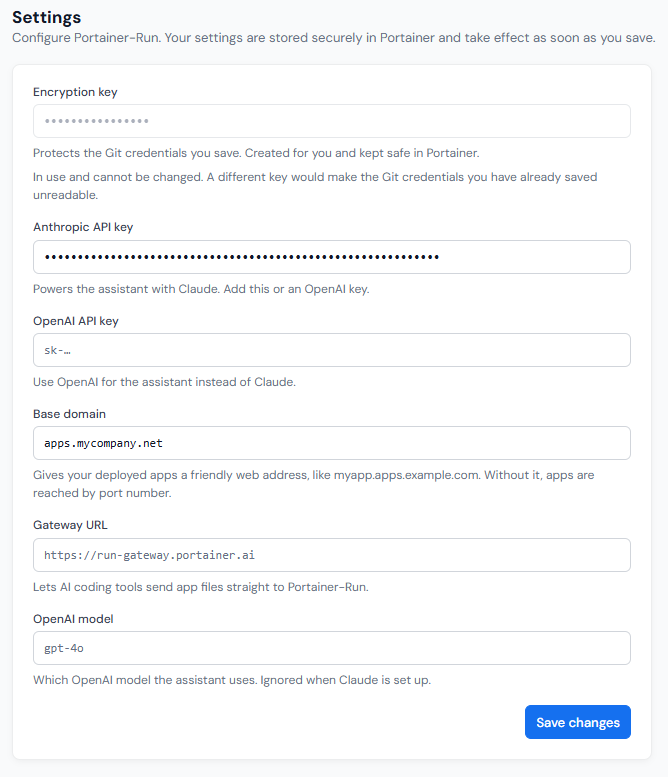

# Settings

This section contains the Portainer-Run configuration settings, and is only available to administrators.

The following options are available:

| Field/Option      | Overview                                                                                                                                                                                                                                                                                                                                                                                                                     |
| ----------------- | ---------------------------------------------------------------------------------------------------------------------------------------------------------------------------------------------------------------------------------------------------------------------------------------------------------------------------------------------------------------------------------------------------------------------------- |
| Encryption key    | The encryption key that was added during initial setup of Portainer-Run, used to encrypt credentials used by Portainer-Run. This cannot be changed.                                                                                                                                                                                                                                                                          |
| Anthropic API key | An Anthropic API key for use with the [Assistant](../assistant.md) functionality. Either this or the OpenAI API key option must be set to enable the Assistant.                                                                                                                                                                                                                                                              |
| OpenAI API key    | An OpenAI API key for use with the [Assistant](../assistant.md) functionality. Either this or the Anthropic API key option must be set to enable the Assistant.                                                                                                                                                                                                                                                              |
| Base domain       | The base domain to apply to applications deployed in Portainer-Run.                                                                                                                                                                                                                                                                                                                                                          |
| Gateway URL       | The file relay that AI coding tools stage application files through when deploying over [MCP](../mcp.md). MCP deploys are disabled until this is set. Portainer hosts a relay at `https://run-gateway.portainer.ai`, but application source passes through it, so egress-restricted or air-gapped installs should host their own. A hostname without a scheme is treated as `https://`. Browser uploads don't use the relay. |
| OpenAI model      | Specifies the OpenAI model to use when using OpenAI for the [Assistant](../assistant.md). This field is ignored when using Anthropic as the AI provider.                                                                                                                                                                                                                                                                     |

<figure><figcaption></figcaption></figure>

### If the encryption key changes

Portainer-Run fingerprints the encryption key against the Git targets it protects. If the key changes, Settings reports it along with the number of Git targets the new key can't read, and Git target and deploy requests are refused until an administrator acts. You have two options:

* **Restore the original key** in Portainer. Everything is readable again with no further action.
* **Continue with the new key.** This deletes the Git targets the new key can't read. Users will need to recreate them.

Git targets deleted this way aren't lost straight away. Portainer-Run copies each one into the `connections_orphaned` table of its database (`/app/data/portainer-run.db`) first. To recover them, restore the key that encrypted them in Portainer, copy the rows back, and restart the Portainer-Run pod:


```bash
kubectl exec -n <namespace> <run-pod> -- node -e "const db = new (require('node:sqlite').DatabaseSync)('/app/data/portainer-run.db'); db.exec('INSERT OR IGNORE INTO connections SELECT id, name, type, encrypted_payload, owner_id, shared, created_at FROM connections_orphaned; DELETE FROM connections_orphaned')"
```


Any Git targets created under the other key then show as unreadable, and the same choice applies to them.
